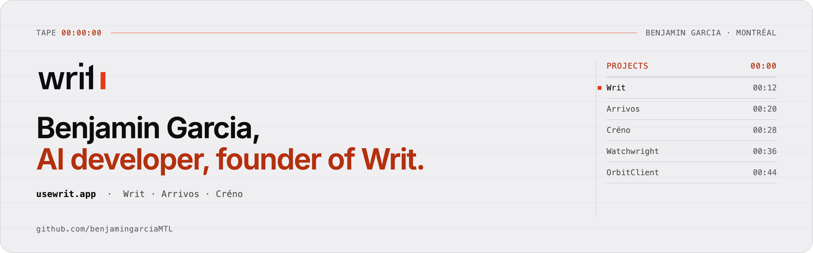

<a href="https://usewrit.app"><picture>
  <source media="(prefers-color-scheme: dark)" srcset="./assets/cover-dark.png">
  
</picture></a>

## Benjamin Garcia

AI developer and founder of **[Writ](https://usewrit.app)**, in Montréal. I build automation and AI
software for problems I see in real day-to-day operations, and I ship it to people who use it every
day.

### What I build

**[Writ](https://usewrit.app)**: your own API to any website. You tell it what you need from a
site; it builds the API, tests it, and signs in as you when the site needs a login. Your code, your
AI assistant (over MCP) or a schedule then calls it like any other API, on Writ Cloud or on your own
computer with Writ Desktop. Launched in August 2026. The open-source parts are in
[github.com/usewrit](https://github.com/usewrit): the
[plugin](https://github.com/usewrit/writ-plugins) for Claude, Codex, Cursor and Gemini CLI, the
[MCP bridge](https://github.com/usewrit/writ-mcp), the [SDKs](https://github.com/usewrit/writ-sdks)
and the [agent](https://github.com/usewrit/writ-agent).

**[Arrivos](https://app.arrivos.app)**: AI reads supplier invoices, matches each line to the right
item, and the person receiving the delivery checks it instead of typing it in. About a minute per
invoice instead of fifteen, and one mistyped line no longer throws off stock, orders, costs and
accounting. The first version was in production within a week.

**Créno**: staff scheduling that builds itself from a traffic forecast, everyone's availability and
fairness, with a mobile app for the team. Built in four months, and in daily use in a real store for
about a year and a half.

**Watchwright** (alpha, not public yet): a Rust engine that keeps a live model of a browser page for
AI agents, so they get cheap diffs, verified actions and reliable settle detection instead of
re-reading the whole page.

**[OrbitClient](https://github.com/retroblack26/OrbitClient)**: an open-source Electron client for
the game DarkOrbit, with a plugin system. It's where my browser-automation work started.

### My path

- Self-taught since I was eleven, when modding games turned into wanting to understand what I was
  actually changing. Desktop applications and websites came next.
- At seventeen I registered as a sole trader doing on-site computer repair, and built websites for
  local businesses alongside it.
- 2023-2024: [OrbitClient](https://github.com/retroblack26/OrbitClient), an open-source Electron
  client with a plugin system, and my start in browser automation.
- 2025: Créno, scheduling with demand forecasting, in production since.
- 2026: Writ launched in August, Arrivos went into production, Watchwright reached alpha.

### How I work

AI tooling is a real part of how one person ships this much, and I would rather say so than have you
wonder. It compounds what I already knew (full-stack, DevOps, and the operational side of running
things other people depend on) instead of standing in for it. The architecture, the reviews and the
verification are mine. I don't ship what I haven't watched work end to end.

### Contact

- [usewrit.app](https://usewrit.app) · [Documentation](https://usewrit.app/docs/)
- [LinkedIn](https://www.linkedin.com/in/benjaminmtl/)
- benjamin@usewrit.app
